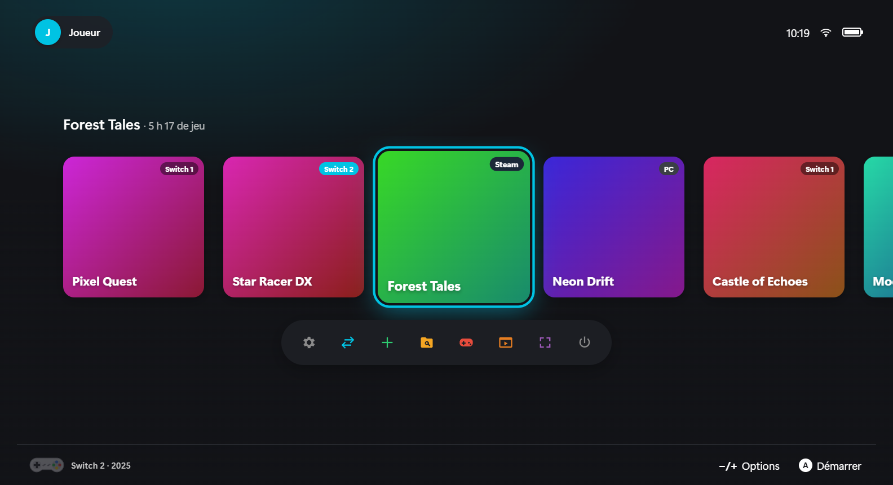
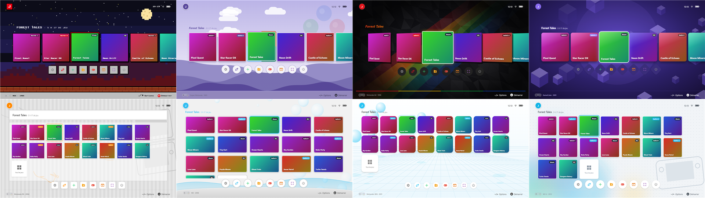
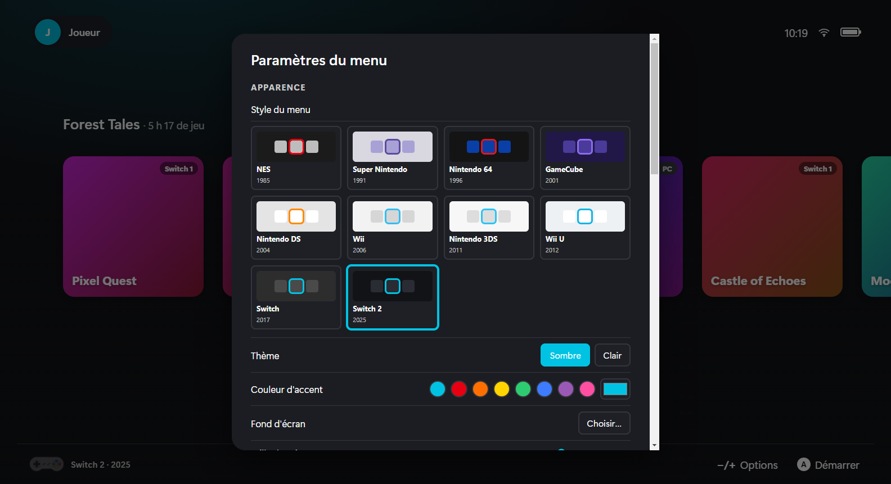
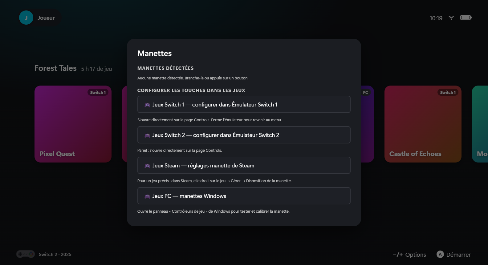

# Console Launcher

Un menu d'accueil plein écran, pilotable à la manette, qui regroupe **tous mes jeux au même endroit** : jeux Switch (via émulateur), jeux Steam et jeux PC. L'interface reprend l'ambiance des menus de consoles Nintendo, avec **10 styles** au choix, de la NES à la Switch 2.

Projet perso réalisé avec **Electron** (HTML / CSS / JavaScript), sans framework.



## Fonctionnalités

- **Une seule bibliothèque pour tout**
  - Jeux Switch 1 et Switch 2 lancés avec l'émulateur de son choix (un par console)
  - Jeux Steam installés, filtrés selon leur **compatibilité manette** (données de la boutique Steam)
  - Dossiers de jeux PC : chaque sous-dossier devient un jeu, l'exécutable principal est détecté automatiquement
  - La liste se met à jour à chaque ouverture : un jeu ajouté apparaît tout seul, rien ne se perd

- **Jaquettes automatiques**
  - Switch : image carrée de l'eShop européen, recherchée par titre
  - Steam / PC : jaquette verticale de Steam (API `IStoreBrowseService` pour les jeux récents)
  - Logo transparent en secours (Steam ou SteamGridDB avec une clé API facultative)
  - Bouton **« Rechercher une nouvelle image »** qui propose une grille d'images au choix

- **Profil Steam** : pseudo, avatar et temps de jeu lus dans les fichiers locaux de Steam (aucun mot de passe, rien n'est envoyé en ligne)

- **Manettes**
  - Navigation complète à la manette (Gamepad API) ou au clavier
  - Disposition Nintendo sur manette Xbox (A/B et X/Y inversés), désactivable
  - Testeur de manette en direct
  - Raccourci qui ouvre l'émulateur **directement sur sa page de configuration des manettes** (automatisation de l'interface Windows avec UI Automation, voir `open-controls.ps1`)

- **10 styles** : NES, Super Nintendo, Nintendo 64, GameCube, Nintendo DS, Wii, Nintendo 3DS, Wii U, Switch, Switch 2
  - Fonds d'écran **dessinés en SVG** par un script (`tools/gen-backgrounds.js`), sans aucune image externe
  - Styles en rangée ou en grille, avec la navigation adaptée



| Paramètres | Manettes |
|---|---|
|  |  |

## Installation

Il faut [Node.js](https://nodejs.org/) (version 18 ou plus récente) et Windows.

```bash
git clone https://github.com/Sky720FR/console-launcher.git
cd console-launcher
npm install
npm start
```

Au premier lancement, ouvre **Paramètres** (touche `S`, `-` / `+` ou le bouton ⚙) pour indiquer :
- le chemin de tes émulateurs Switch 1 / Switch 2 (section *Émulateurs*)
- tes dossiers de jeux Switch et PC

Les réglages sont enregistrés dans `%APPDATA%\console-launcher\config.json` (avec une copie de secours).

## Commandes

| Manette | Clavier | Action |
|---|---|---|
| Croix / joystick | Flèches | Se déplacer |
| A | Entrée | Lancer le jeu |
| B | Échap | Retour |
| X | X | Options du jeu (jaquette, nom, console) |
| Y | Y / Tab | Changer de style |
| − / + | S | Paramètres |

## Structure

```
main.js              processus principal : scan des jeux, Steam, jaquettes, lancement
preload.js           pont sécurisé entre l'interface et main.js
renderer.js          interface : rendu, navigation, fenêtres, manettes
index.html           structure de la page
style.css            mise en page et styles Switch / Switch 2
themes.css           styles des anciennes consoles
backgrounds/         fonds d'écran SVG générés
tools/               script de génération des fonds d'écran
open-controls.ps1    ouvre l'émulateur sur sa page "Controls"
fonts/               police pixel (Press Start 2P, licence OFL)
```

## Crédits

- Police **Press Start 2P** par CodeMan38, sous licence SIL Open Font License
- Données et images de jeux récupérées à l'exécution depuis Steam, l'eShop Nintendo et (en option) SteamGridDB ; elles ne sont pas incluses dans ce dépôt
- Les captures d'écran utilisent des jeux fictifs

Projet personnel non affilié à Nintendo ni à Valve. Les noms de consoles sont utilisés uniquement pour désigner le style dont chaque thème s'inspire ; tous les visuels sont des créations originales.
